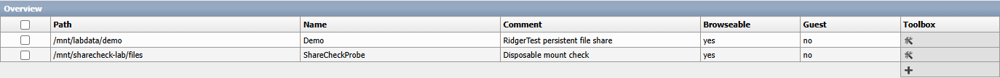
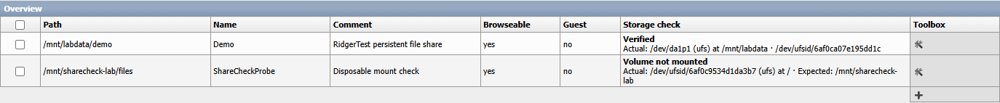
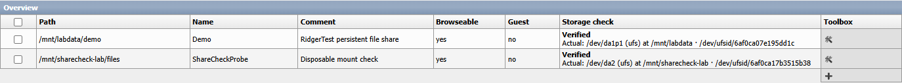

# Xigmap

**Where is this SMB share actually writing?** Xigmap adds a read-only **Storage check** column to the XigmaNAS **Services → SMB → Shares** page. The name joins *Xigma* and *map*. It is an independent derivative of XigmaNAS 14.3.0.5.10566.

## A write can succeed on the wrong disk

Two independent Full installations were given disposable UFS test volumes. Each had a writable directory beneath its test mount. With that volume unmounted, Windows successfully wrote and read a unique SMB marker on each server. Inside each guest, the marker's device number equalled that of the root filesystem. Restoring the correct volume revealed its original marker and covered the misplaced file.

**Upstream, with the volume absent**

**Xigmap, under the same fault**

**Xigmap, after restoring the volume**

## Reading the column

| Result | Meaning |
| --- | --- |
| Verified | The live mount and its UFS identity match the configured expectation. |
| Volume not mounted | The expected mount is absent. The actual backing mount is displayed. |
| Volume mismatch | A different UFS identity occupies the expected mount point. |
| Different mount | The resolved directory is on another mount, such as a nested filesystem or symlink target. |
| Directory missing | The share directory is absent or inaccessible. Check the path and permissions. |
| Unverified | A reliable identity or observation is unavailable. This includes unmanaged ZFS datasets in this version. |

The grid takes one mount-table snapshot per render. It walks complete path components, resolves the actual directory, and compares its backing volume to the longest applicable configured mount. UFS provider lookups are cached per render. This is a point-in-time diagnostic. It neither intercepts Samba writes nor changes mounts or permissions.

See the [diagnostic](etc/inc/services/samba/share/storage_check.php), [grid](etc/inc/services/samba/share/grid_toolbox.php), [regression tests](ridgerlab/test_storage_check.php) and [observations from the guests](evidence/observations.json).

## Build and run

The [build instructions](ridgerlab/BUILD.txt) cover both compressed UFS payloads, the translation catalogue and the bootable ISO. On a blank guest, choose Full / GPT, finish installation, disconnect the optical media and start from disk. The reference machines used BIOS, 2 vCPUs and 5 GiB RAM. The EFI boot catalogue was inspected; the tested installation path was BIOS/GPT. The Embedded payload and upstream kernel and services are reused.

## Provenance

This is a native fork of the [XigmaNAS GitHub repository](https://github.com/XigmaNAS/xigmanas). The appliance source comes from the [Subversion trunk at revision 10566](https://svn.code.sf.net/p/xigmanas/code/!svn/rvr/10566/trunk/). The [upstream release](https://sourceforge.net/projects/xigmanas/files/XigmaNAS-14.3.0.5/14.3.0.5.10566/) supplies the verified base installer. The history separates the upstream import, RidgerLab branding and the new storage diagnostic. Original notices are retained in [build/COPYRIGHT](build/COPYRIGHT) and the source files. XigmaNAS is an upstream registered trademark.
